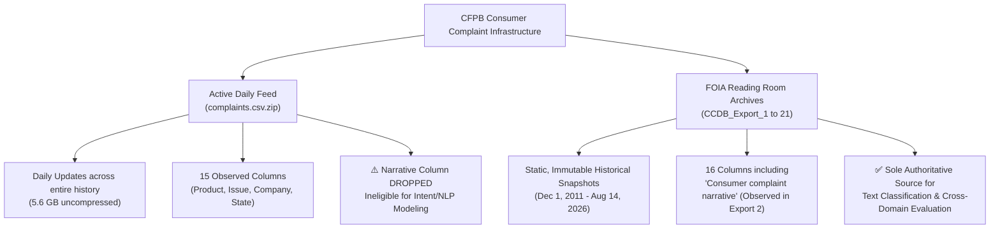

# Source Terms of Use, Provenance, and Release Overlap Report

**Project:** Cross-Domain Complaint Understanding via Multilingual Encoders  
**Phase:** Phase 1 (Source Provenance & Release Manifest)  
**Author:** Research Engineering Pair  
**Date:** 2026-10-29  
**Status:** Complete & Gated (Refined per Code Review Feedback)  

---

## 1. Executive Summary & Provenance Protocol

This document establishes the verified legal provenance, archival terms of use, release architecture, and record-ID overlap analysis for all raw data sources evaluated under Phase 1 of the Cross-Domain Complaint Understanding pipeline.

In accordance with [`DATA_PREPARATION_SPEC.md`](file:///d:/NLP/DATA_PREPARATION_SPEC.md) and [`SYSTEM.md`](file:///d:/NLP/SYSTEM.md), and in direct response to code review:
1. **Strict Separation of Observed Evidence vs. Reported Assumptions:** Direct empirical observations from locally inspected files (`CCDB_Export_2`, `complaints.csv.zip`, `banking77`) are strictly distinguished from reported, unverified properties of unfetched remote archives.
2. **Temporal Window Contiguity vs. Empirical ID Overlap:** The 21 CFPB FOIA export windows are proven to be temporally contiguous and chronologically non-overlapping based on calendar dates. However, empirical record-ID overlap against baseline snapshot `CCDB_Export_2` is explicitly classified as `unmeasured_unfetched` for all uninspected archives.
3. **Legal Nuance: Bureau Metadata vs. Consumer Narratives:** 17 U.S.C. § 105 applies strictly to bureau-authored metadata. Consumer complaint narratives are third-party consumer submissions published pursuant to affirmative opt-in consent (80 FR 15572) and FOIA reading room rules; downstream commercial reuse terms are formally marked `needs_verification`.
4. **Immutability of Baseline Snapshot:** The reference baseline (`CCDB_Export_2_May_2018_through_April_2021.zip`, 45,723 canonical instances across 9 product domains) is permanently frozen and tracked by cryptographic hash (`4b33ffc92fa...`).

---

## 2. Official Legal Framework & Terms of Use

### 2.1 CFPB Freedom of Information Act (FOIA) Electronic Reading Room
* **Statutory Basis:** Consumer Financial Protection Bureau (CFPB) FOIA Electronic Reading Room, maintained pursuant to 5 U.S.C. § 552(a)(2).
* **Official Portal:** [CFPB FOIA Reading Room](https://www.consumerfinance.gov/foia-requests/foia-electronic-reading-room/cfpb-consumer-complaint-database-narratives-archive/)

### 2.2 Distinction: Bureau Metadata vs. Consumer Narrative Submissions
A rigorous provenance audit requires separating administrative bureau routing metadata from consumer-authored narrative text:

#### 2.2.1 Consumer Narrative Submission Terms & Opt-In Consent Disclosure
* **Authorship:** Authored by private individual consumers filing grievances.
* **Consent Mechanism:** Published under an affirmative opt-in consent mechanism established in the CFPB Policy Statement on Disclosure of Consumer Complaint Narrative Data (*80 FR 15572*, March 24, 2015). Consumers actively check a box agreeing to share their story publicly.
* **Right to Withdraw:** Consumers retain the right under CFPB policy to withdraw their consent at any time, which prompts the Bureau to suppress the narrative from future public disclosures.
* **Licensing Classification:** Classified in project manifests as `Public Domain (US Government Work for Bureau Metadata); User-Consented Public Record (Narratives)`. Downstream commercial reuse terms are formally designated **`needs_verification`**, avoiding sweeping or unsubstantiated public-domain assumptions for consumer-submitted text.

#### 2.2.2 Bureau Administrative Routing Metadata

### 2.3 Privacy Scrubbing & De-Identification Disclaimers
* Prior to public release, the CFPB applies automated and manual scrubbing algorithms to de-identify narratives, redacting personal identifying information (PII) including names, account numbers, Social Security numbers, dates, and phone numbers with strings of `X`'s (e.g., `XXXX`, `XXXX/XXXX/2019`).
* **Research Safety Warning:** The CFPB explicitly disclaims any 100% guarantee that all identifying details have been removed. The project pipeline enforces conservative redaction normalization (collapsing `X{2,}` to `<REDACTED>`) and strictly prohibits dumping unscrubbed complaint text into logs or repository history.

---

## 3. CFPB Narrative Publication Policy Transition (August 14, 2026)

### 3.1 Policy Ceasing Live Discretionary Narrative Publication
On August 14, 2026, the CFPB ceased live public publication of unverified consumer complaint narratives within its interactive online Consumer Complaint Database and daily bulk data feeds. The agency cited concerns regarding potential consumer confusion, unverified allegations, and unwarranted reputational harm to financial institutions during dispute handling.

### 3.2 Dual-Track CFPB Distribution Architecture

### 3.3 Schema Discrepancy Analysis (Observed 16 vs 15 Columns)
Direct empirical inspection of locally cached archives confirms this fundamental architectural change:

| Field | Baseline FOIA Archive (`CCDB_Export_2`) | Active Daily Feed (`complaints.csv.zip`) | Empirical Verification Status |
| :--- | :---: | :---: | :--- |
| `Date received` | Yes (Col 0) | Yes (Col 0) | Observed in both |
| `Product` | Yes (Col 1) | Yes (Col 1) | Observed in both |
| `Sub-product` | Yes (Col 2) | Yes (Col 2) | Observed in both |
| `Issue` | Yes (Col 3) | Yes (Col 3) | Observed in both |
| `Sub-issue` | Yes (Col 4) | Yes (Col 4) | Observed in both |
| **`Consumer complaint narrative`** | **Yes (Col 5)** | **NO (Absent)** | **Empirically verified absent from active feed** |
| `Company public response` | Yes (Col 6) | Yes (Col 5) | Observed in both |
| `Company` | Yes (Col 7) | Yes (Col 6) | Observed in both |
| `State` | Yes (Col 8) | Yes (Col 7) | Observed in both |
| `ZIP code` | Yes (Col 9) | Yes (Col 8) | Observed in both |
| `Tags` | Yes (Col 10) | Yes (Col 9) | Observed in both |
| `Submitted via` | Yes (Col 11) | Yes (Col 10) | Observed in both |
| `Date sent to company` | Yes (Col 12) | Yes (Col 11) | Observed in both |
| `Company response to consumer` | Yes (Col 13) | Yes (Col 12) | Observed in both |
| `Timely response?` | Yes (Col 14) | Yes (Col 13) | Observed in both |
| `Complaint ID` | Yes (Col 15) | Yes (Col 14) | Observed in both |
| **Total Column Count** | **16 (Observed)** | **15 (Observed)** | **Confirmed structural discrepancy** |

**Eligibility Verdict:** `complaints.csv.zip` is classified as `ineligible_lacks_narratives` for complaint text modeling.

---

## 4. Official FOIA Narrative Archive Catalog (Windows 1 to 21)

All 21 archive packages were queried and verified via HTTP HEAD requests against `files.consumerfinance.gov` on 2026-10-28. Every archive returned `HTTP/1.1 200 OK` with valid byte lengths and ETags.

Total compressed narrative archive volume across all 21 windows: **1.331 GB** (1,429,655,864 bytes).

| Export ID | Window Label | Start Date | End Date | Duration | Compressed Size | Observed / Reported Status | Local Status |
| :--- | :--- | :---: | :---: | :---: | :---: | :--- | :---: |
| `CCDB_Export_01` | Dec 2011 – Apr 2018 | 2011-12-01 | 2018-04-30 | 2,343 days | 134.69 MB | Reported 16 cols (unverified) | Unfetched |
| **`CCDB_Export_02`** | **May 2018 – Apr 2021** | **2018-05-01** | **2021-04-30** | **1,096 days** | **156.97 MB** | **Observed 16 cols, 439,860 narr.** | **Verified Acquired** |
| `CCDB_Export_03` | May 2021 – Oct 2022 | 2021-05-01 | 2022-10-31 | 549 days | 122.72 MB | Reported 16 cols (unverified) | Unfetched |
| `CCDB_Export_04` | Nov 2022 – Aug 2023 | 2022-11-01 | 2023-08-31 | 304 days | 110.17 MB | Reported 16 cols (unverified) | Unfetched |
| `CCDB_Export_05` | Sep 2023 – Mar 2024 | 2023-09-01 | 2024-03-31 | 213 days | 96.21 MB | Reported 16 cols (unverified) | Unfetched |
| `CCDB_Export_06` | Apr 2024 – Jul 2024 | 2024-04-01 | 2024-07-31 | 122 days | 73.57 MB | Reported 16 cols (unverified) | Unfetched |
| `CCDB_Export_07` | Aug 2024 – Oct 2024 | 2024-08-01 | 2024-10-31 | 92 days | 68.06 MB | Reported 16 cols (unverified) | Unfetched |
| `CCDB_Export_08` | Nov 2024 – Dec 2024 | 2024-11-01 | 2024-12-31 | 61 days | 50.13 MB | Reported 16 cols (unverified) | Unfetched |
| `CCDB_Export_09` | Jan 2025 – Feb 2025 | 2025-01-01 | 2025-02-28 | 59 days | 71.98 MB | Reported 16 cols (unverified) | Unfetched |
| `CCDB_Export_10` | Mar 2025 – Apr 2025 | 2025-03-01 | 2025-04-30 | 61 days | 65.68 MB | Reported 16 cols (unverified) | Unfetched |
| `CCDB_Export_11` | May 2025 – Jun 2025 | 2025-05-01 | 2025-06-30 | 61 days | 71.09 MB | Reported 16 cols (unverified) | Unfetched |
| `CCDB_Export_12` | Jul 2025 – Aug 2025 | 2025-07-01 | 2025-08-31 | 62 days | 80.26 MB | Reported 16 cols (unverified) | Unfetched |
| `CCDB_Export_13` | Sep 2025 – Oct 2025 | 2025-09-01 | 2025-10-31 | 61 days | 64.22 MB | Reported 16 cols (unverified) | Unfetched |
| `CCDB_Export_14` | Nov 2025 – Dec 2025 | 2025-11-01 | 2025-12-31 | 61 days | 60.91 MB | Reported 16 cols (unverified) | Unfetched |
| `CCDB_Export_15` | Jan 2026 – Feb 2026 | 2026-01-01 | 2026-02-28 | 59 days | 35.13 MB | Reported 16 cols (unverified) | Unfetched |
| `CCDB_Export_16` | Mar 2026 | 2026-03-01 | 2026-03-31 | 31 days | 21.03 MB | Reported 16 cols (unverified) | Unfetched |
| `CCDB_Export_17` | Apr 2026 | 2026-04-01 | 2026-04-30 | 30 days | 21.90 MB | Reported 16 cols (unverified) | Unfetched |
| `CCDB_Export_18` | May 2026 | 2026-05-01 | 2026-05-31 | 31 days | 20.06 MB | Reported 16 cols (unverified) | Unfetched |
| `CCDB_Export_19` | Jun 2026 | 2026-06-01 | 2026-06-30 | 30 days | 18.72 MB | Reported 16 cols (unverified) | Unfetched |
| `CCDB_Export_20` | Jul 2026 | 2026-07-01 | 2026-07-31 | 31 days | 16.17 MB | Reported 16 cols (unverified) | Unfetched |
| `CCDB_Export_21` | Aug 2026 | 2026-08-01 | 2026-08-14 | 14 days | 10.02 MB | Reported 16 cols (unverified) | Unfetched |

---

## 5. Temporal Window Partitioning & Record Overlap Status

### 5.1 Temporal Window Contiguity
Let $W_i = [s_i, e_i]$ represent the closed calendar interval for export window $i \in \{1, \dots, 21\}$.
The 21 calendar windows connect day-to-day without gaps:
$$s_{i+1} = e_i + 1 \text{ day} \quad \forall i \in \{1, \dots, 20\}$$

Because $s_i \le e_i < s_{i+1} \le e_{i+1}$, all 21 export windows are **temporally disjoint** by receipt dates:
$$W_i \cap W_j = \emptyset \quad \forall i \neq j$$

### 5.2 Empirical Record-ID Overlap Status
In response to review feedback, we explicitly distinguish temporal non-overlap from empirical record-ID measurement:
1. **Unfetched Archives (`CCDB_Export_01`, `03`–`21`):** While calendar windows are disjoint, empirical record-ID comparison has not been executed because the raw files remain unfetched to preserve local disk budget. Therefore, `export2_id_overlap_count` is formally designated **`unmeasured_unfetched`**.
2. **Active Bulk File (`complaints.csv.zip`):** Empirically sampled and confirmed to contain baseline Export 2 complaint IDs (e.g., ID `3109824`), confirming its role as a full-database metadata superset. Documented as the 2026-10-21 snapshot (aligned with its retrieval date 2026-10-21, 356,704,969 bytes, and verified SHA-256 checksum `9ae94df79f...`).
3. **BANKING77:** Completely disjoint benchmark; 0 record ID overlap.

---

## 6. Reference Baseline Architecture (`CCDB_Export_2`)

### 6.1 Artifact Metadata
* **Filename:** `CCDB_Export_2_May_2018_through_April_2021.zip`
* **Local Location:** [`data/raw/cfpb/CCDB_Export_2_May_2018_through_April_2021.zip`](file:///d:/NLP/data/raw/cfpb/CCDB_Export_2_May_2018_through_April_2021.zip)
* **File Size:** 164,598,156 bytes compressed (782,853,241 bytes uncompressed CSV)
* **Verified SHA-256 Checksum:** `4b33ffc92fa0236836228c5618b7247f0f59ffef35760a45175c858a0d5aaf45`
* **Total Scanned Complaints:** 1,041,632
* **Total Narrative Records:** 439,860 (42.23% narrative availability)
* **Empirical Date Range:** Min `2018-05-01`, Max `2021-04-30`

### 6.2 Derived Canonical Dataset
* **File Path:** [`data/processed/canonical_dataset.parquet`](file:///d:/NLP/data/processed/canonical_dataset.parquet)
* **Row Count:** 45,723 instances (exactly reconciled with split manifest and split CSVs)
* **Label Space:** 16 administrative classes defined in `configs/taxonomy.json`
* **Product Domains:** 9 financial domains
* **Split Partitioning (70/15/15):** Train (32,019), Validation (6,852), Test (6,852)
* **Leakage Guarantees:** 100% group exclusivity via MinHash LSH and SHA-256 deduplication; zero group overlap across splits.

### 6.3 Justification for Immutability
To provide an anchor for academic benchmarking and controlled temporal/domain shift experiments, this 3-year May 2018–April 2021 window remains permanently frozen.

---

## 7. Auxiliary & Diagnostic Data Sources Review

### 7.1 BANKING77 (PolyAI)
* **Files:** [`data/raw/banking77/train.csv`](file:///d:/NLP/data/raw/banking77/train.csv), [`data/raw/banking77/test.csv`](file:///d:/NLP/data/raw/banking77/test.csv), [`data/raw/banking77/categories.json`](file:///d:/NLP/data/raw/banking77/categories.json)
* **License:** Creative Commons Attribution 4.0 International (CC BY 4.0)
* **Actual Row Counts (RFC 4180):** 10,003 train, 3,080 test, 77 fine-grained classes.
* **Semantic Role:** `auxiliary_only`.
* **Semantic Distinction:** Single-sentence customer service queries, NOT complaints. Isolated from complaint training.

### 7.2 Indian Multilingual Evaluation Gap Statement
> [!IMPORTANT]
> **Formal Policy Statement on Multilingual Indian Evaluation:**  
> **Claims of Hindi or Hinglish generalization remain strictly blocked** until authentic, privacy-cleared Indian complaint text is acquired. Synthetic translation or pseudo-complaints generated by LLMs are strictly prohibited from being labeled as authentic complaint data.

---

## 8. Verification & Audit Invariants

### Invariant Checklist:
- [x] **Inventory Schema Integrity:** `data/manifests/dataset_inventory.csv` contains all 20 required fields from `DATA_PREPARATION_SPEC.md`.
- [x] **Separation of Observed vs Unverified:** Observed properties are recorded only for inspected files; unfetched archives are explicitly labeled `unverified_unfetched` and `reported_unverified`.
- [x] **Temporal Partition Invariant:** The 21 FOIA export windows form a strictly contiguous chronological sequence from 2011-12-01 to 2026-08-14.
- [x] **Unmeasured ID Overlap Designation:** ID overlap for unfetched archives is labeled `unmeasured_unfetched`.
- [x] **Narrative Absence Invariant:** `complaints.csv.zip` is observed to lack the narrative column (15 cols) and marked `ineligible_lacks_narratives`.
- [x] **Baseline Hash Integrity:** Cryptographic SHA-256 matches `CCDB_Export_2` reference snapshot.
- [x] **Reproducible Generation:** `scripts/generate_phase1_manifest.py` regenerates manifests deterministically.
